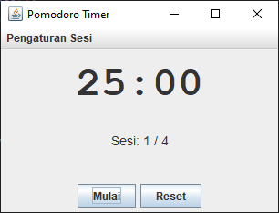
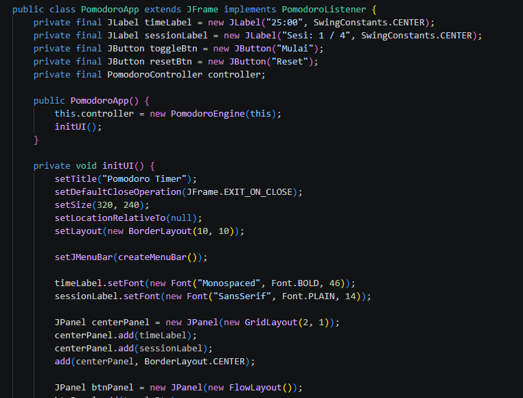
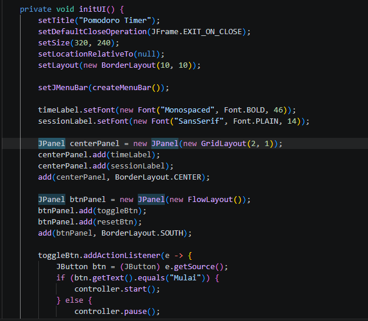
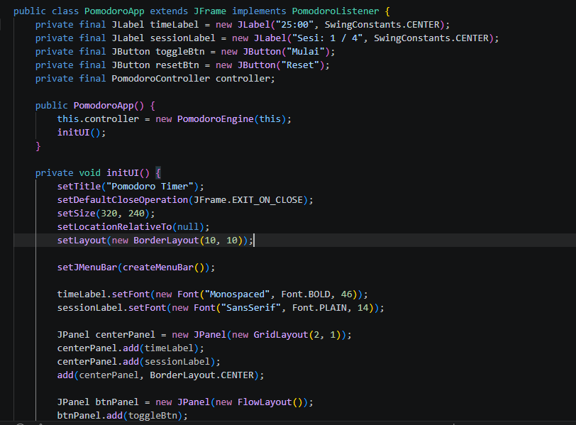
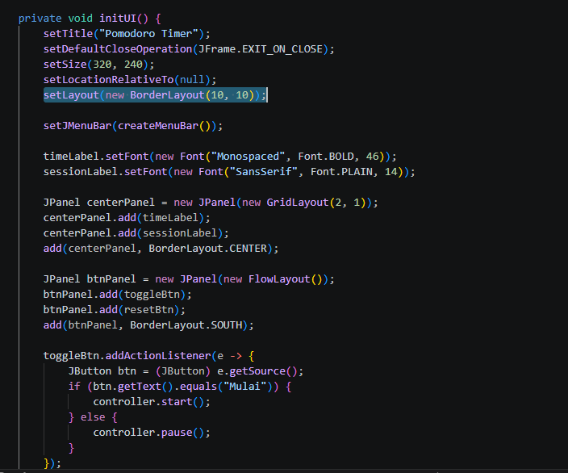
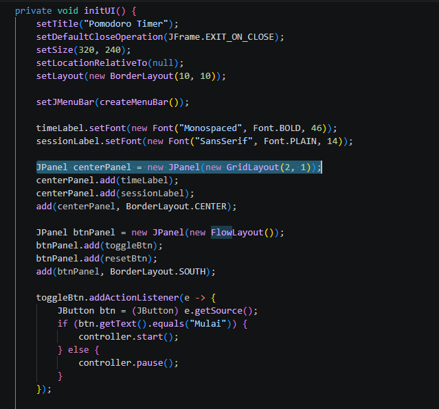

# Pomodoro-GUI

Java Swing desktop Pomodoro timer.



## Features

- 25-minute work intervals.
- Session tracker with audio alert on completion.
- Session presets (2, 4, 6, 8) and custom count via menu bar.
- Start, pause, resume, and reset controls.

## GUI Components

1. **Top-Level Container (`JFrame`):** Main application window hosting all views.
   
2. **Intermediate Container (`JPanel`):** Groups layout panels (`centerPanel`, `btnPanel`).
   
3. **Atomic Components (`JLabel`, `JButton`):** Timer/session labels and action buttons.
   
4. **Layout Managers (`BorderLayout`, `GridLayout`, `FlowLayout`):** Controls spatial arrangement across window areas.
   
   
5. **Menu System (`JMenuBar`, `JMenu`, `JMenuItem`):** Dropdown interface for session configuration and custom presets.

## Architecture

- **Pattern:** Separation of concerns via interfaces (`PomodoroController`, `PomodoroListener`).
- **Engine:** Event-driven countdown using `javax.swing.Timer`.

## Run

```bash
javac PomodoroApp.java
java PomodoroApp
```
